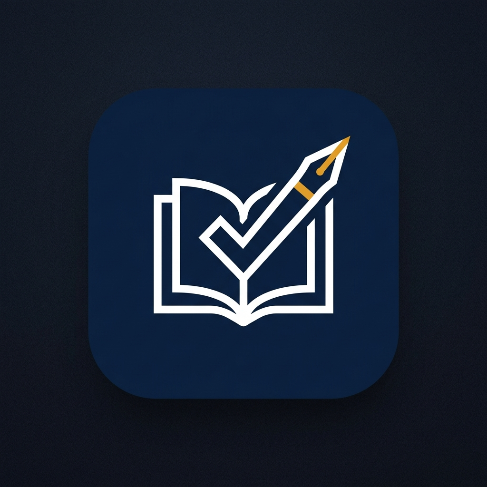

  
  
  # Bitácora Docente para Android
  ### 📱 Canal Oficial de Lanzamientos, Descargas y Versiones Beta
  
  
  
  
  

   

  

---

## 📖 Acerca de Bitácora Docente

**Bitácora Docente** es la herramienta integral definitiva para educadores, profesores y maestros. Diseñada desde el aula, permite gestionar la jornada diaria escolar de manera ágil, sin conexión a internet permanente y con sincronización inteligente en la nube.

### 🌟 Características Principales:

* **⚡ Asistencia con 1 Toque:** Registro ultra rápido de Presentes, Ausentes, Tardes y Justificadas sin fricción.
* **📊 Planilla Académica y Calificaciones:** Libro de calificaciones flexible con soporte para regímenes numéricos (1-10) y conceptuales (PBA: TEA, TEP, TED, etc.).
* **📅 Cronograma de la Jornada:** Visualización clara de clases del día, división, turno e institución educativa.
* **☁️ Arquitectura Offline-First:** Toda la información se guarda de forma segura en tu teléfono (Room DB) y se sincroniza automáticamente con la nube (Firebase Firestore) cuando hay conexión.
* **🔄 Actualizaciones Integradas:** La app cuenta con un actualizador automático integrado que te avisa cuando hay una nueva versión disponible y la instala sin complicaciones.
* **🎨 Paletas Personalizables:** Adaptación total a tu estilo con 6 temas de color y soporte nativo para Modo Oscuro.

---

## 📲 Cómo Instalar en tu Celular Android

1. **Descargá el archivo APK:** Tocá el botón azul superior o ingresá a la sección [Releases](https://github.com/julianmcancelo/BitacoraDocente-App/releases).
2. **Abrí el archivo descargado:** Al finalizar la descarga, tocá la notificación de descarga o buscalo en la carpeta *Descargas* de tu teléfono.
3. **Autorizá la instalación:** Si es la primera vez que instalás un APK externo, Android te pedirá habilitar *"Instalar aplicaciones de fuentes desconocidas"*. Aceptá el permiso para continuar.
4. **¡Listo!** Abrí Bitácora Docente, iniciá sesión con tu cuenta de Google y empezá a organizar tus clases.

---

## 📦 Historial de Versiones (Changelog)

Consultá todas las versiones anteriores, notas de cambios y binarios en:
👉 **[Ver todos los Releases](https://github.com/julianmcancelo/BitacoraDocente-App/releases)**

---

  Desarrollado con ❤️ para la comunidad docente · 2026

